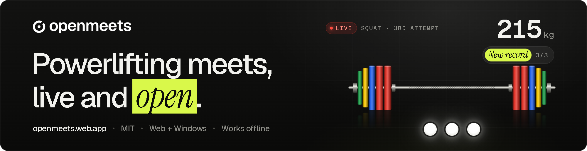
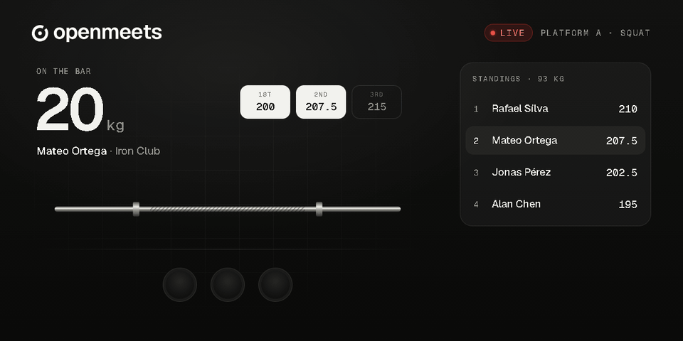
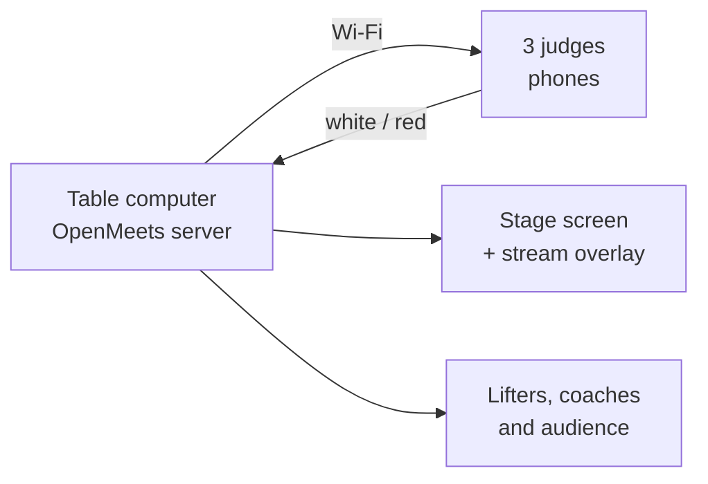

  

&nbsp;
&nbsp;

  

<picture>
  <source media="(prefers-color-scheme: dark)" srcset="marca/logotipo-blanco.svg">
  
</picture>

### Run a powerlifting meet live, from one laptop at the table.

**Free and open source. Use it on the web, or install it at the venue and run the whole meet without internet.**

[Get started](#get-started) · [How it works](#how-it-works) · [Features](#features) · [FAQ](#faq) · [Documentation](docs/index.html) · [Brand manual](marca/manual.pdf)

 

---

One computer runs the table. The three judges vote from their phones, and the lights come up at the same moment on the stage screen, in the stream overlay and on every phone in the room. Lifters, coaches and the audience follow the meet live from their own phones.

## Get started

There are two ways to use OpenMeets. Both have the same app; they differ in where the meet lives.

| | Web | Windows app |
| --- | --- | --- |
| **Install** | Nothing | `OpenMeets-Setup.exe` |
| **Internet at the venue** | Needed | Not needed |
| **Account** | Google sign-in to organize | None |
| **Best for** | Trying it out, small meets, meets with good Wi-Fi | Competition day in a gym |

### On the web

Open [openmeets.web.app](https://openmeets.web.app) and sign in with Google to create your meets. Judges, screens and spectators just open the link you share; they never need an account.

### At the venue (Windows app)

1. Download `OpenMeets-Setup.exe` from the [latest release](https://github.com/eyversao/openmeets/releases/latest).
2. Run it. The installer walks you through the license, the install folder and the shortcuts, and can open OpenMeets when it's done.
3. Open OpenMeets on the table computer. It shows the address the phones should open and the organizer PIN.
4. Connect the judges' phones, the stage screen and anyone else to the same Wi-Fi. If the gym has no Wi-Fi, turn on the laptop's hotspot or use a phone's.

The first time it runs, Windows asks about the Firewall: allow **private networks** so the phones can connect. The [quick guide](docs/guia-rapida.html) covers the rest.

<a href="#readme-top">↑ back to top</a>

## How it works

In the Windows app everything runs on the table computer. The server is written in Rust and it's very fast, so an ordinary laptop can serve every phone in the gym. Meets are saved on that computer, and the app opens without a connection. Nothing goes to the cloud unless you choose to publish.

The web version at openmeets.web.app is static files on Firebase Hosting with Firestore behind them. There is no server of ours in the middle, and each Google account owns the meets it creates.

## Features

| For | What you get |
| --- | --- |
| **The table** | Clock, bar weight and plate loading, running order, attempts and results, with Undo on every action. |
| **Judges** | They vote from a phone, and the lights show only when all three have voted. The table can approve each phone with one tap or hand out a 6-digit code. Bluetooth and USB remotes work too. |
| **Stage and stream** | Big lights for the venue, a transparent strip for OBS, and a broadcast desk that picks what the overlay shows and exports social images with the meet's branding. |
| **Audience** | Live, upcoming and finished meets; rankings by category, division and club; personal bests, records, and applause for each lifter. |
| **Registration** | Entries and weigh-in inside OpenMeets, with no spreadsheet. Contact details stay visible only to you. |
| **Records** | A profile for every lifter and a record table that keeps who holds each mark and who held it before. |
| **Federations** | A PIN per staff member, a panel with every platform, an announcer sheet, a change log and official exports. |
| **Languages** | The app is in Spanish and English. The documentation is in Spanish. |

## Requirements

- **Web:** a recent Chrome, Edge, Safari or Firefox.
- **Windows app:** Windows 10 or 11 for the table computer. Phones and screens only need a browser.
- Bluetooth and USB judge remotes need desktop Chrome or Edge.

## Documentation

The [`docs/`](docs/index.html) folder is a static site: setup, organizing a meet, registration and weigh-in, running the table, judges and remotes, the screen and OBS, the broadcast desk, records, federation mode, and the technical notes (API and data model). Open `docs/index.html` in a browser and keep the folders together, since it uses the fonts and styles in `web/`.

The logo, the brand manual, the images in this README and the installer's interface are in [`marca/`](marca/LEEME.md).

## FAQ

<strong>Do I need internet at the venue?</strong>

Not with the Windows app. The table computer serves everything over the gym's network. The web version does need a connection.

<strong>What do the judges need?</strong>

A phone on the same Wi-Fi as the table. If you prefer physical remotes, the `mandos/` folder has Arduino and ESP32 sketches to build them.

<strong>How do I stop strangers from voting?</strong>

Use the **table** approval mode, where the table approves each judge's phone with one tap, or the **code** mode, where the table gives out a 6-digit code. Changing the code locks out every phone that had the old one.

<strong>Where is my data, and how do I back it up?</strong>

In the Windows app, under `%LOCALAPPDATA%\OpenMeets\datos`. Copy that folder to back it up. Uninstalling OpenMeets leaves it alone unless you tick the box that deletes it. On the web, your meets are stored with your Google account.

<strong>Is OpenMeets affiliated with LiftingCast or the IPF?</strong>

No. It takes ideas from LiftingCast, but it isn't affiliated with LiftingCast, the IPF or any federation.

## License

[MIT](LICENSE) © 2026 Eyver Gomez. You can use it, copy it and change it, including for paid meets.

## Author

Made by **Eyver Gomez** ([@eyversao](https://instagram.com/eyversao) · [GitHub](https://github.com/eyversao)).

<a href="#readme-top">↑ back to top</a>

