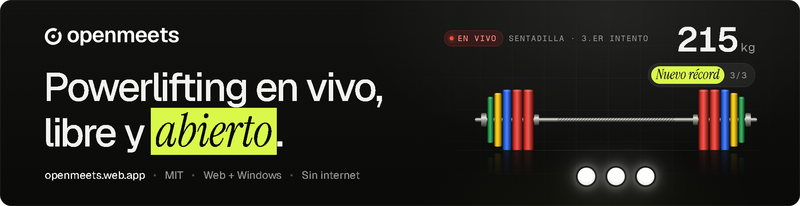
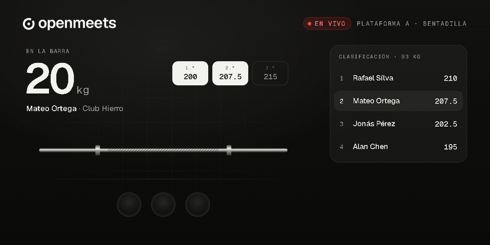
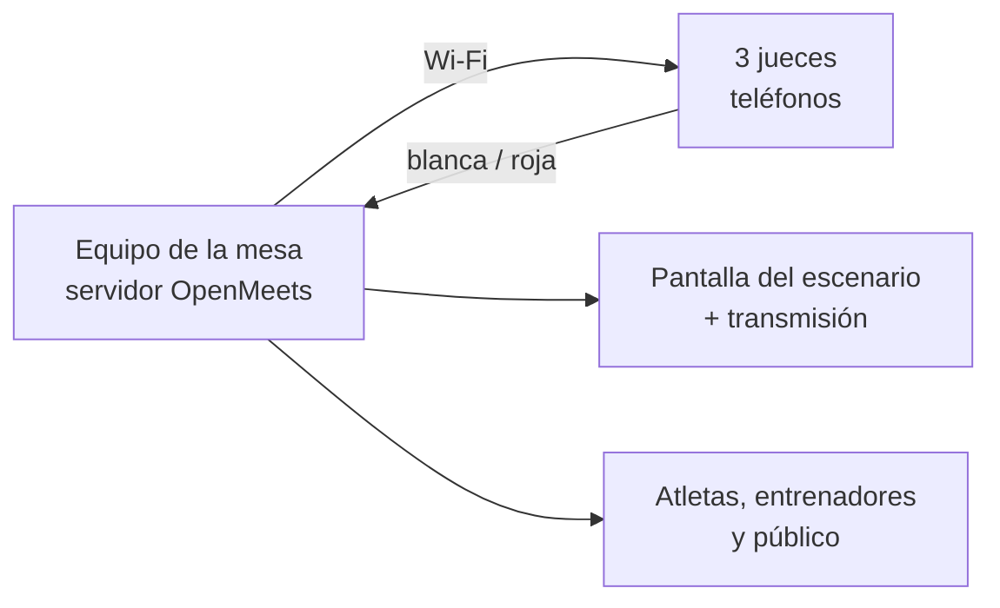

  

&nbsp;
&nbsp;

  

<picture>
  <source media="(prefers-color-scheme: dark)" srcset="../../marca/logotipo-blanco.svg">
  
</picture>

### Una competencia de powerlifting en vivo, desde un portátil en la mesa.

**Gratis y de código abierto. Úsalo en la web, o instálalo en el gimnasio y lleva todo el meet sin internet.**

[Empezar](#empezar) · [Cómo funciona](#cómo-funciona) · [Funciones](#funciones) · [Preguntas](#preguntas-frecuentes) · [Documentación](../index.html) · [Manual de marca](../../marca/manual.pdf)

 

---

Un solo equipo lleva la mesa. Los tres jueces votan con el teléfono y las luces se encienden a la vez en la pantalla del escenario, en la transmisión y en todos los teléfonos de la sala. Atletas, entrenadores y público siguen el meet en vivo desde su propio teléfono.

## Empezar

OpenMeets se usa de dos formas. La app es la misma; cambia dónde vive el meet.

| | Web | App para Windows |
| --- | --- | --- |
| **Instalar** | Nada | `OpenMeets-Setup.exe` |
| **Internet en el gimnasio** | Hace falta | No hace falta |
| **Cuenta** | Google, para organizar | Ninguna |
| **Para** | Probarlo, meets pequeños o con buena Wi-Fi | El día de la competencia en un gimnasio |

### En la web

Entra en [openmeets.web.app](https://openmeets.web.app) e inicia sesión con Google para crear tus meets. Jueces, pantallas y público solo abren el enlace que compartes; nunca necesitan cuenta.

### En el gimnasio (app para Windows)

1. Descarga `OpenMeets-Setup.exe` de la [última versión](https://github.com/eyversao/openmeets/releases/latest).
2. Ábrelo. El asistente te lleva por la licencia, la carpeta de instalación y los accesos directos, y puede abrir OpenMeets al terminar.
3. Abre OpenMeets en el equipo de la mesa. Te muestra la dirección que deben abrir los teléfonos y el PIN del organizador.
4. Conecta a la misma Wi-Fi los teléfonos de los jueces, la pantalla del escenario y a quien quiera seguirlo. Si el gimnasio no tiene Wi-Fi, activa el hotspot del portátil o el de un teléfono.

La primera vez, Windows pregunta por el Firewall: permite las **redes privadas** para que se conecten los teléfonos. El resto está en la [guía rápida](../guia-rapida.html).

<a href="#readme-top">↑ volver arriba</a>

## Cómo funciona

En la app para Windows todo corre en el equipo de la mesa. El servidor está escrito en Rust y es muy rápido: un portátil normal atiende todos los teléfonos del gimnasio. Los meets se guardan en ese equipo y la app abre sin conexión. Nada sube a la nube salvo que decidas publicarlo.

La versión web de openmeets.web.app son archivos estáticos en Firebase Hosting con Firestore detrás. No hay un servidor nuestro en medio, y cada cuenta de Google es dueña de los meets que crea.

## Funciones

| Para | Qué tienes |
| --- | --- |
| **La mesa** | Reloj, peso en la barra y carga de discos, orden de salida, intentos y resultados, con Deshacer en cada acción. |
| **Jueces** | Votan con el teléfono y las luces solo se muestran cuando han votado los tres. La mesa aprueba cada teléfono con un toque o reparte un código de 6 dígitos. También sirven mandos Bluetooth y USB. |
| **Escenario y transmisión** | Luces grandes para la sala, una franja transparente para OBS y una regie que elige qué muestra la franja y exporta imágenes para redes con la marca del meet. |
| **Público** | Meets en vivo, próximos y terminados; clasificaciones por categoría, división y club; marcas personales, récords y aplausos para cada atleta. |
| **Inscripciones** | Inscripción y pesaje dentro de OpenMeets, sin hoja de cálculo. Los datos de contacto solo los ves tú. |
| **Récords** | Un perfil por atleta y una tabla de récords que guarda quién tiene cada marca y quién la tuvo antes. |
| **Federaciones** | Un PIN por persona del equipo, un panel con todas las tarimas, hoja del locutor, registro de cambios y exportaciones oficiales. |
| **Idiomas** | La app está en español e inglés. La documentación, en español. |

## Requisitos

- **Web:** Chrome, Edge, Safari o Firefox recientes.
- **App para Windows:** Windows 10 u 11 en el equipo de la mesa. Los teléfonos y las pantallas solo necesitan un navegador.
- Los mandos de jueces Bluetooth y USB necesitan Chrome o Edge de escritorio.

## Documentación

La carpeta [`docs/`](../index.html) es un sitio estático: instalación, organizar un meet, inscripciones y pesaje, dirigir la mesa, jueces y mandos, pantalla y OBS, la regie, récords, el modo federación y las notas técnicas (API y modelo de datos). Abre `docs/index.html` en el navegador y no separes las carpetas, porque usa las fuentes y estilos de `web/`.

El logo, el manual de marca, las imágenes de este README y la interfaz del instalador están en [`marca/`](../../marca/LEEME.md).

## Preguntas frecuentes

<strong>¿Necesito internet en el gimnasio?</strong>

Con la app para Windows, no. El equipo de la mesa lo sirve todo por la red del gimnasio. La versión web sí necesita conexión.

<strong>¿Qué necesitan los jueces?</strong>

Un teléfono en la misma Wi-Fi que la mesa. Si prefieres mandos físicos, en la carpeta `mandos/` hay programas para Arduino y ESP32 para armarlos.

<strong>¿Cómo evito que vote un desconocido?</strong>

Usa la aprobación por **mesa**, donde la mesa aprueba con un toque el teléfono de cada juez, o por **código**, donde la mesa reparte un código de 6 dígitos. Si cambias el código, quedan fuera todos los teléfonos que tenían el anterior.

<strong>¿Dónde están mis datos y cómo los respaldo?</strong>

En la app para Windows, en `%LOCALAPPDATA%\OpenMeets\datos`. Copia esa carpeta para respaldarlos. Desinstalar OpenMeets no la toca, salvo que marques la casilla que la borra. En la web, tus meets se guardan con tu cuenta de Google.

<strong>¿OpenMeets tiene relación con LiftingCast o la IPF?</strong>

No. Toma ideas de LiftingCast, pero no está afiliado a LiftingCast, a la IPF ni a ninguna federación.

## Licencia

[MIT](../../LICENSE) © 2026 Eyver Gomez. Puedes usarlo, copiarlo y cambiarlo, también en competencias de pago.

## Autor

Hecho por **Eyver Gomez** ([@eyversao](https://instagram.com/eyversao) · [GitHub](https://github.com/eyversao)).

<a href="#readme-top">↑ volver arriba</a>

