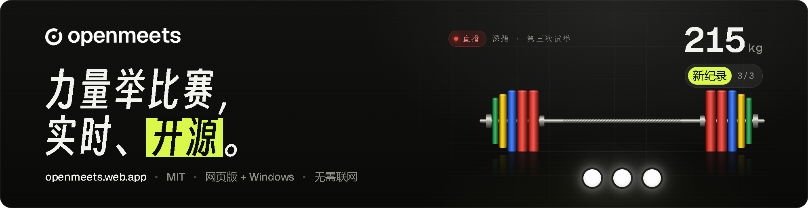
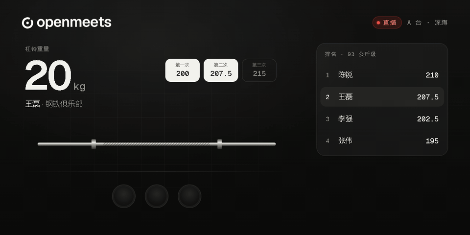
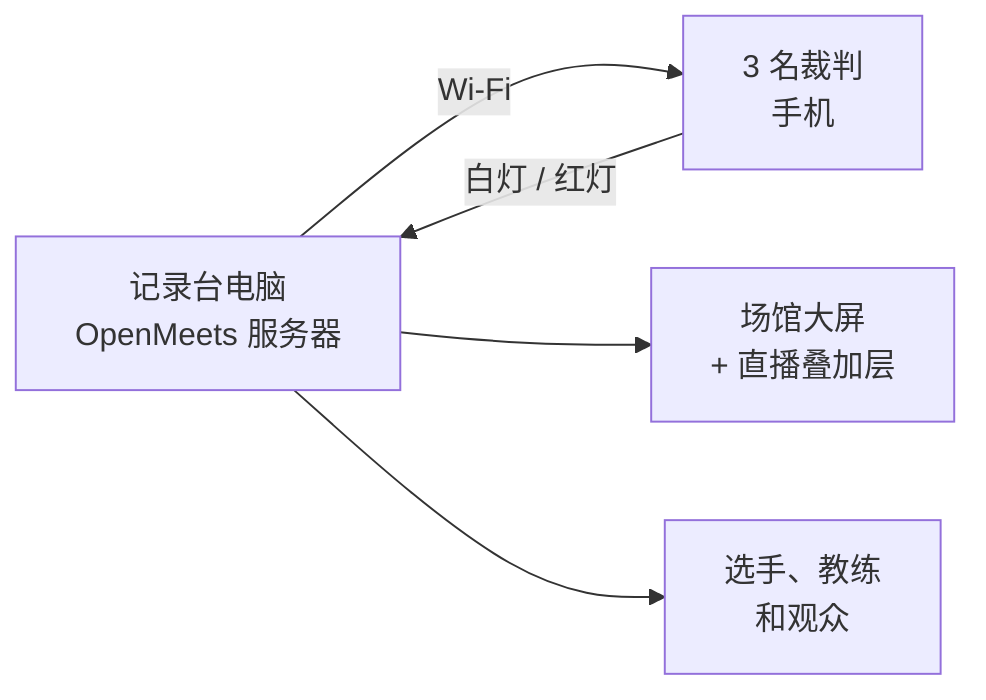

  

&nbsp;
&nbsp;

  

<picture>
  <source media="(prefers-color-scheme: dark)" srcset="../../marca/logotipo-blanco.svg">
  
</picture>

### 一台记录台电脑，就能实时运行一场力量举比赛。

**免费、开源。可以直接在网页上使用，也可以装在比赛场馆的电脑上，全程不需要互联网。**

[开始使用](#开始使用) · [工作原理](#工作原理) · [功能](#功能) · [常见问题](#常见问题) · [文档（西班牙语）](../index.html) · [品牌手册](../../marca/manual.pdf)

 

> [!NOTE]
> 应用界面提供西班牙语和英语，暂无中文界面；文档为西班牙语。

---

一台电脑负责记录台。三名裁判用手机投票，判定灯会同时出现在场馆大屏、直播画面和现场每一部手机上。选手、教练和观众都可以用自己的手机实时关注比赛。

## 开始使用

OpenMeets 有两种用法。应用本身相同，区别在于比赛数据存放在哪里。

| | 网页版 | Windows 应用 |
| --- | --- | --- |
| **安装** | 无需安装 | `OpenMeets-Setup.exe` |
| **场馆网络** | 需要互联网 | 不需要互联网 |
| **账号** | 组织比赛需 Google 登录 | 无需账号 |
| **适合** | 试用、小型比赛、网络良好的场地 | 在健身房举办的正式比赛日 |

### 网页版

打开 [openmeets.web.app](https://openmeets.web.app)，用 Google 登录即可创建比赛。裁判、大屏和观众只需打开你分享的链接，不需要任何账号。

### 在比赛场馆（Windows 应用）

1. 从[最新版本](https://github.com/eyversao/openmeets/releases/latest)下载 `OpenMeets-Setup.exe`。
2. 运行安装程序。向导会依次带你确认许可证、选择安装文件夹和快捷方式，完成后可以直接打开 OpenMeets。
3. 在记录台电脑上打开 OpenMeets，它会显示手机要访问的地址和组织者 PIN。
4. 让裁判的手机、场馆大屏和其他观众连接同一个 Wi-Fi。场馆没有 Wi-Fi 时，打开笔记本或手机的热点即可。

第一次运行时，Windows 会询问防火墙设置：请允许**专用网络**，这样手机才能连接。其余步骤见[快速指南](../guia-rapida.html)（西班牙语）。

<a href="#readme-top">↑ 返回顶部</a>

## 工作原理

在 Windows 应用中，一切都运行在记录台电脑上。服务器用 Rust 编写，速度很快，一台普通笔记本就能同时服务场馆里的所有手机。比赛数据保存在这台电脑上，应用在没有网络时也能打开。除非你选择发布，否则不会上传任何内容。

openmeets.web.app 上的网页版是托管在 Firebase Hosting 上的静态文件，数据存放在 Firestore。中间没有我们自己的服务器，每个 Google 账号拥有自己创建的比赛。

## 功能

| 对象 | 功能 |
| --- | --- |
| **记录台** | 计时器、杠铃重量与杠片配置、出场顺序、试举与成绩，每个操作都可撤销。 |
| **裁判** | 用手机投票，三人都投完后判定灯才会显示。记录台可以一键批准每部手机，也可以发放 6 位数验证码。也支持蓝牙和 USB 遥控器。 |
| **场馆与直播** | 现场大屏显示大号判定灯，OBS 使用透明信息条；导播台决定信息条显示的内容，并导出带有赛事品牌的社交媒体图片。 |
| **观众** | 直播中、即将开始和已结束的比赛；按级别、组别和俱乐部排名；个人最佳、纪录，还可以为每位选手鼓掌。 |
| **报名** | 在 OpenMeets 内完成报名和称重，不需要电子表格。联系方式只有你能看到。 |
| **纪录** | 每位选手都有档案；纪录表保存每项纪录的现保持者和前保持者。 |
| **协会** | 每位工作人员一个 PIN、所有比赛台的总面板、播报员表、修改日志和官方导出。 |
| **语言** | 应用支持西班牙语和英语，文档为西班牙语。 |

## 系统要求

- **网页版：** 较新版本的 Chrome、Edge、Safari 或 Firefox。
- **Windows 应用：** 记录台电脑需要 Windows 10 或 11。手机和大屏只需要浏览器。
- 蓝牙和 USB 裁判遥控器需要桌面版 Chrome 或 Edge。

## 文档

[`docs/`](../index.html) 文件夹是一个静态网站（西班牙语）：安装、组织比赛、报名与称重、记录台操作、裁判与遥控器、大屏与 OBS、导播台、纪录、协会模式，以及技术说明（API 和数据模型）。在浏览器中打开 `docs/index.html` 即可；它使用 `web/` 中的字体和样式，请保持文件夹结构不变。

标志、品牌手册、本 README 中的图片以及安装程序的界面都在 [`marca/`](../../marca/LEEME.md) 中。

## 常见问题

<strong>比赛场馆需要互联网吗？</strong>

使用 Windows 应用时不需要。记录台电脑通过场馆的局域网提供全部服务。网页版需要联网。

<strong>裁判需要什么？</strong>

一部与记录台连接同一 Wi-Fi 的手机。如果想用实体遥控器，`mandos/` 文件夹里有 Arduino 和 ESP32 的程序，可以自己制作。

<strong>如何防止陌生人投票？</strong>

使用**记录台**审批模式（记录台一键批准每位裁判的手机），或**验证码**模式（记录台发放 6 位数验证码）。更换验证码后，持有旧验证码的手机都会被拒绝。

<strong>数据保存在哪里？如何备份？</strong>

Windows 应用的数据保存在 `%LOCALAPPDATA%\OpenMeets\datos`，复制这个文件夹即可备份。卸载 OpenMeets 不会删除它，除非你勾选了删除数据的选项。网页版的比赛保存在你的 Google 账号下。

<strong>OpenMeets 与 LiftingCast 或 IPF 有关联吗？</strong>

没有。它借鉴了 LiftingCast 的一些想法，但与 LiftingCast、IPF 或任何协会都没有关联。

## 许可证

[MIT](../../LICENSE) © 2026 Eyver Gomez。你可以自由使用、复制和修改，包括用于收费比赛。

## 作者

由 **Eyver Gomez** 制作（[@eyversao](https://instagram.com/eyversao) · [GitHub](https://github.com/eyversao)）。

<a href="#readme-top">↑ 返回顶部</a>

